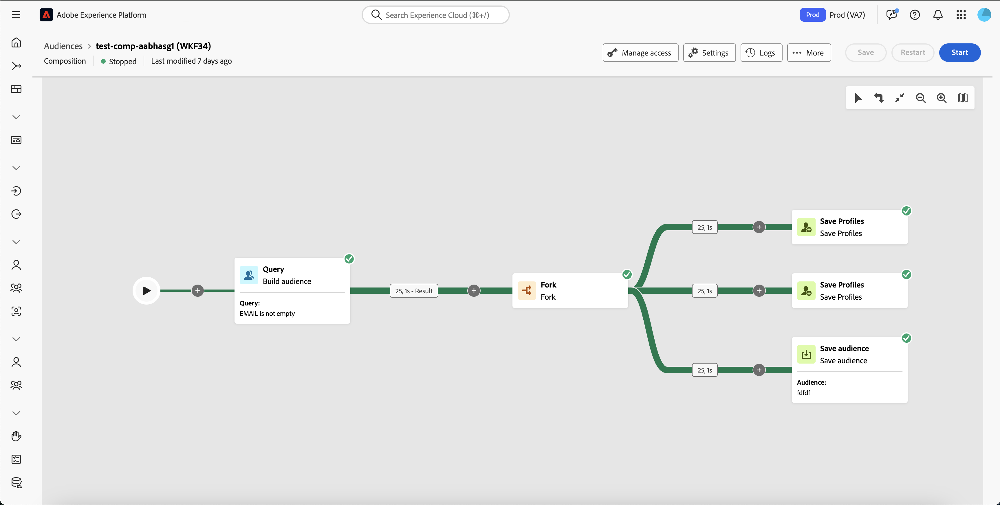
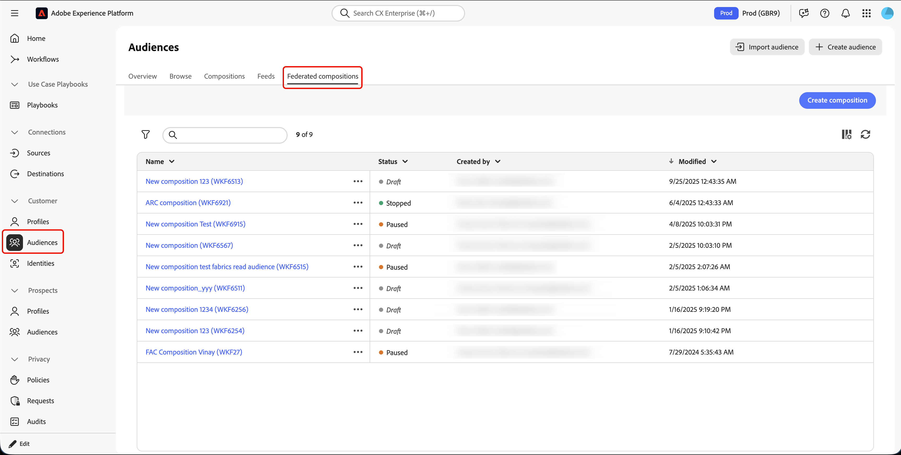
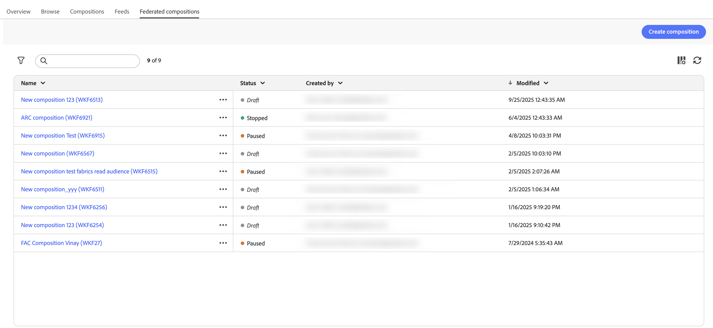
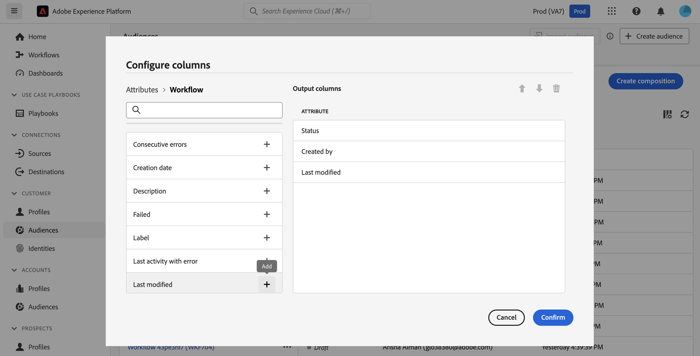
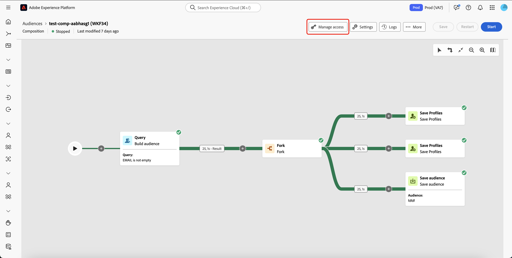
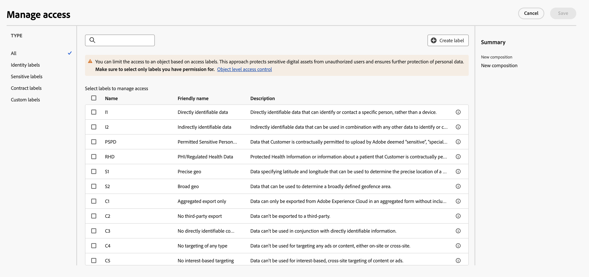

# Vue d’ensemble des compositions

>[!AVAILABILITY]
>
>Pour accéder aux compositions, vous devez disposer de l’une des autorisations suivantes :
>
>-**Gestion des compositions fédérées**
>-**Affichage des compositions fédérées**
>
>Pour plus d’informations sur les autorisations requises, lisez le [guide du contrôle d’accès](/help/governance-privacy-security/access-control.md).

La composition d’audiences fédérées vous permet de créer des compositions, dans lesquelles vous pouvez tirer parti de diverses activités dans une zone de travail visuelle pour créer des audiences. Une fois votre composition créée, les audiences obtenues sont enregistrées dans Adobe Experience Platform et sont prêtes à être utilisées dans des destinations Experience Platform et Adobe Journey Optimizer pour cibler la clientèle.

{zoomable="yes"}{width="70%"}

## Composants de composition {#components}

Une composition au sein de la composition d’audiences fédérées comprend les parties suivantes :

- **[!UICONTROL Activités]** : une activité est une tâche à effectuer, et les activités sont représentées dans la composition par des icônes.
- **[!UICONTROL Transitions]** : les transitions relient une activité source à une activité de destination et définissent leur ordre. Les informations contenues dans les transitions sont stockées dans une table de travail. Chaque composition utilise plusieurs tables de travail. Les données transmises dans ces tables peuvent être utilisées tout au long du cycle de vie de la composition.

## Accéder aux compositions et les gérer {#access}

>[!CONTEXTUALHELP]
>id="dc_composition_list"
>title="Compositions"
>abstract="Dans cet écran, vous pouvez accéder à la liste complète des compositions, vérifier leur statut actuel, les dates de dernière exécution et de prochaine exécution, et créer une nouvelle composition."

Les compositions sont accessibles à partir du menu **[!UICONTROL Audiences]** d’Adobe Experience Platform, dans l’onglet **[!UICONTROL Compositions fédérées]** de la section **[!UICONTROL Clientes et clients]**.

{zoomable="yes"}{width="70%"}

Sur cet écran, vous pouvez afficher des informations sur les compositions et en créer de nouvelles.

{zoomable="yes"}{width="70%"}

| Champ | Description |
| ----- | ----------- |
| **[!UICONTROL Nom]** | Nom de la composition. Si vous sélectionnez la composition, vous pouvez la modifier. Pour plus d’informations sur la création et la modification de compositions, consultez le guide [créer une composition](/help/compositions/create-composition.md). |
| **[!UICONTROL Statut]** | Statut de la composition. Les valeurs possibles sont les suivantes : [!UICONTROL Brouillon], [!UICONTROL En cours], [!UICONTROL Arrêté], [!UICONTROL En pause] et [!UICONTROL En erreur]. <ul><li>**[!UICONTROL Brouillon]** : la composition a été créée et enregistrée.</li><li>**[!UICONTROL En cours]** : la composition a été exécutée et est en cours d’exécution.</li><li>**[!UICONTROL Arrêté]** : l’exécution de la composition est terminée et s’est arrêtée.</li><li>**[!UICONTROL En pause]** : l’exécution de la composition a été suspendue.</li><li>**[!UICONTROL Avec erreur]** : l’exécution de la composition a rencontré une erreur. Pour afficher plus d’informations sur l’erreur, ouvrez la composition et accédez aux journaux.</li></ul> Pour savoir comment démarrer ou arrêter une composition, lisez le guide [créer une composition](./create-composition.md#monitor-logs). |
| **[!UICONTROL Créé par]** | Nom et adresse électronique de la personne qui a créé la composition. |
| **[!UICONTROL Modifié]** | Date et heure de la dernière mise à jour de la composition. |

Vous pouvez également effectuer des actions rapides sur les compositions en sélectionnant le bouton  en regard de leur nom.

| Action | Description |
| ------ | ----------- |
| **[!UICONTROL Doublon]** | Duplique la composition sélectionnée. |
| **[!UICONTROL Supprimer]** | Supprime la composition sélectionnée. |
| **[!UICONTROL Ajouter au package]** | Déplace la composition entre les sandbox. Pour plus d’informations sur cette fonctionnalité, consultez le [guide d’utilisation des sandbox](https://experienceleague.adobe.com/en/docs/experience-platform/sandbox/ui/sandbox-tooling). |

Pour affiner la liste et trouver la composition que vous recherchez, vous pouvez rechercher la liste et filtrer les compositions selon leur statut ou leur date de dernier traitement.

Vous pouvez également personnaliser la liste en ajoutant ou en supprimant des colonnes. Pour ce faire, sélectionnez le bouton **[!UICONTROL Configurer les colonnes]** et ajoutez ou supprimez les colonnes de sortie souhaitées.

{zoomable="yes"}{width="70%"}

### Appliquer les libellés d’accès {#access-labels}

Pour appliquer des libellés d’accès à une composition spécifique, sélectionnez la composition, puis **[!UICONTROL Gérer l’accès]**.

{zoomable="yes"}{width="70%"}

La fenêtre contextuelle **[!UICONTROL Gérer l’accès]** s’affiche. Sur cette page, vous pouvez appliquer les libellés d’accès et de gouvernance des données applicables à votre composition.

{zoomable="yes"}{width="70%"}

| Type de libellé | Description |
| ---------- | ----------- |
| Libellés de contrat | Les libellés de contrat (libellés « C ») sont utilisés pour catégoriser des données qui possèdent des obligations contractuelles ou qui sont liées aux politiques de gouvernance des données de votre organisation. |
| Libellés d’identité | Les libellés d’identité (libellés « I ») servent à catégoriser les données permettant d’identifier ou de contacter une personne spécifique. |
| Libellés sensibles | Les libellés sensibles (libellés « S ») sont utilisés pour catégoriser ce que vous et/ou votre organisation considérez comme sensible. |
| Libellés de réseau partenaire | Les libellés de réseau partenaire servent à catégoriser les données des sources externes à votre organisation. |

Pour plus d’informations sur les libellés d’accès et de gouvernance des données, consultez le [glossaire des libellés d’utilisation des données](https://experienceleague.adobe.com/fr/docs/experience-platform/data-governance/labels/reference).

## Créer {#create}

Vous pouvez créer une composition pour Adobe Experience Platform à l’aide de la composition d’audiences. Pour plus d’informations, consultez le [guide de création d’une composition](./create-composition.md).

## Étapes suivantes

Après avoir lu ce guide, vous avez appris à accéder aux libellés d’accès, à les gérer et à en créer pour vos compositions. Pour plus d’informations sur l’utilisation des audiences dans leur ensemble, lisez le [guide des audiences](../start/audiences.md).
