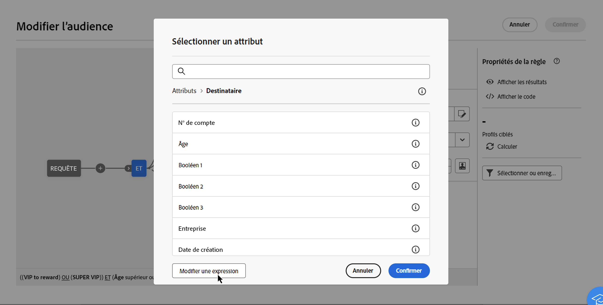
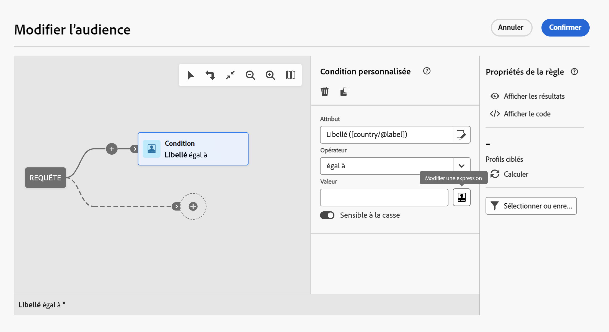
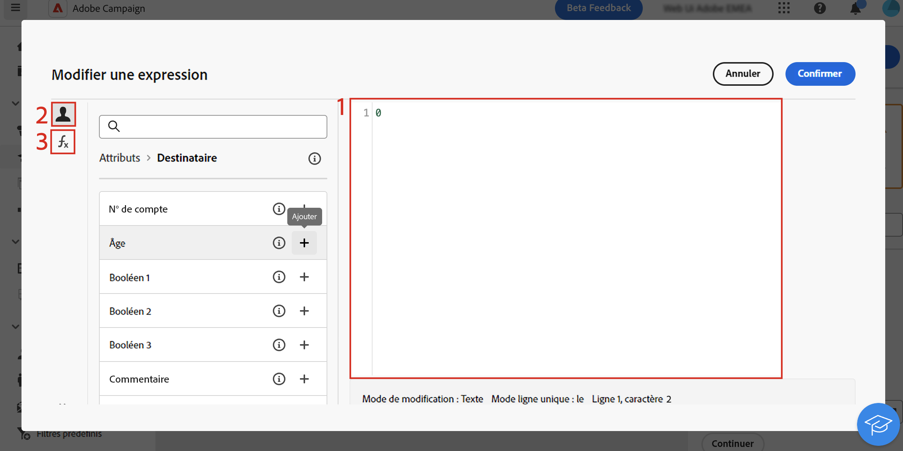
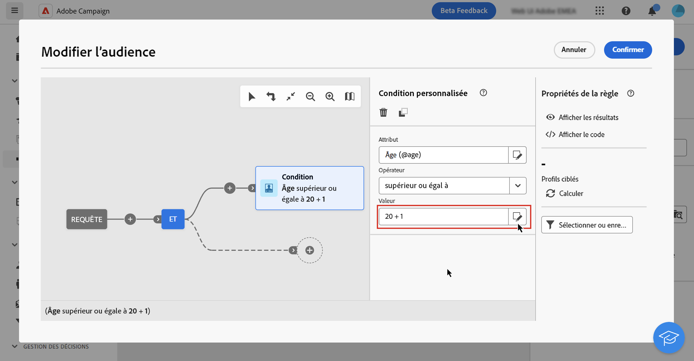

# Vue d’ensemble de l’éditeur d’expression {#expression}

La modification d’une expression consiste à saisir manuellement des conditions pour former une règle. Ce mode permet d’utiliser des fonctions avancées, vous permettant ainsi de manipuler les valeurs utilisées afin de réaliser des requêtes spécifiques : manipulation de dates, de chaînes, de champs numériques, tris, etc.

## Utiliser l’éditeur d’expression {#edit}

L’éditeur d’expression est disponible à partir du bouton **[!UICONTROL Modifier une expression]** du concepteur de requête, disponible pour les champs **[!UICONTROL Attribut]** et **[!UICONTROL Valeur]** lors de la configuration d’une condition personnalisée.

| Accéder depuis le champ **[!UICONTROL Attribut]** | Accéder depuis le champ **[!UICONTROL Valeur]** |
|  ---  |  ---  |
| {zoomable="yes"}{width="200" align="center" zoomable="yes"} | {zoomable="yes"}{width="200" align="center" zoomable="yes"} |

L’éditeur d’expression fournit :

* un **champ de saisie (1)**, dans lequel l’expression est définie ;
* la liste des **champs (2)** disponibles, utilisables dans l’expression et correspondant au schéma, ou dimension de ciblage, de la requête ;
* des **fonctions d’assistance (3)**, triées par catégorie.

Modifiez l’expression en saisissant une expression directement dans le champ de saisie. Pour ajouter un champ ou une fonction d’assistance, placez le curseur dans l’expression à l’endroit où vous souhaitez l’ajouter, puis sélectionnez le bouton +.

{zoomable="yes"}

Lorsque votre expression est prête, sélectionnez **[!UICONTROL Confirmer]**. L’expression s’affiche dans le champ sélectionné. Pour la modifier, ouvrez l’éditeur d’expression et apportez les modifications souhaitées.

L’exemple ci-dessous présente une expression configurée pour le champ **[!UICONTROL Valeur]**. Pour la modifier, vous devez ouvrir l’éditeur d’expression à l’aide du bouton **[!UICONTROL Modifier une expression]**.

{zoomable="yes"}

## Fonctions d’assistance

L’outil d’édition de requêtes permet d’utiliser des fonctions avancées pour réaliser un filtrage complexe en fonction des résultats souhaités et des types de données manipulées. Les fonctions suivantes sont disponibles :

### Date

Les fonctions de date sont utilisées pour manipuler des valeurs de date ou d’heure.

>[!BEGINTABS]

>[!TAB Google BigQuery]

| Nom | Description | Syntaxe | Exemple |
| ---- | ----------- | ------ | ------- |
| **AddYears** | Ajoute le nombre d’années spécifié à la date et à l’heure indiquées. | AddYears(&lt;DATEHEURE>, &lt;NOMBRE>) | AddYears(&quot;2019-12-25 15:30:00&quot;, 3) |
| **AddMonths** | Ajoute le nombre de mois spécifié à la date et à l’heure indiquées. | AddMonths(&lt;DATEHEURE>, &lt;NOMBRE>) | AddMonths(&quot;2019-12-25 15:30:00&quot;, 6) |
| **AddDays** | Ajoute le nombre de jours spécifié à la date et à l’heure indiquées. | AddDays(&lt;DATEHEURE>, &lt;NOMBRE>) | AddDays(&quot;2019-12-25 15:30:00&quot;, 10) |
| **AddHours** | Ajoute le nombre d’heures spécifié à la date et à l’heure indiquées. | AddHours(&lt;DATEHEURE>, &lt;NOMBRE>) | AddHours(&quot;2019-12-25 15:30:00&quot;, 3) |
| **AddMinutes** | Ajoute le nombre de minutes spécifié à la date et à l’heure indiquées. | AddMinutes(&lt;DATEHEURE>, &lt;NOMBRE>) | AddMinutes(&quot;2019-12-25 15:30:00&quot;, 32) |
| **AddSeconds** | Ajoute le nombre de secondes spécifié à la date et à l’heure indiquées. | AddSeconds(&lt;DATEHEURE>, &lt;NOMBRE>) | AddSeconds(&quot;2019-12-25 15:30:00&quot;, 37) |
| **SubYears** | Soustrait le nombre d’années spécifié de la date et de l’heure indiquées. | SubYears(&lt;DATEHEURE>, &lt;NOMBRE>) | SubYears(&quot;2019-12-25 15:30:00&quot;, 3) |
| **SubMonths** | Soustrait le nombre de mois spécifié à la date et à l’heure indiquées. | SubMonths(&lt;DATEHEURE>, &lt;NOMBRE>) | SubMonths(&quot;2019-12-25 15:30:00&quot;, 6) |
| **SubDays** | Soustrait le nombre de jours spécifié à la date et à l’heure indiquées. | SubDays(&lt;DATEHEURE>, &lt;NOMBRE>) | SubDays(&quot;2019-12-25 15:30:00&quot;, 10) |
| **SubHours** | Soustrait le nombre d’heures spécifié à la date et à l’heure indiquées. | SubHours(&lt;DATEHEURE>, &lt;NOMBRE>) | SubHours(&quot;2019-12-25 15:30:00&quot;, 3) |
| **SubMinutes** | Soustrait le nombre de minutes spécifié à la date et à l’heure indiquées. | SubMinutes(&lt;DATEHEURE>, &lt;NOMBRE>) | SubMinutes(&quot;2019-12-25 15:30:00&quot;, 32) |
| **SubSeconds** | Soustrait le nombre de secondes spécifié à la date et à l’heure indiquées. | SubSeconds(&lt;DATEHEURE>, &lt;NOMBRE>) | SubSeconds(&quot;2019-12-25 15:30:00&quot;, 37) |
| **Year** | Extrait l’année de l’objet date/heure donné. | Year(&lt;DATEHEURE>) | Year(&quot;2019-12-15 15:30:00&quot;) |
| **Month** | Extrait le mois de l’objet date/heure donné. | Month(&lt;DATEHEURE>) | Month(&quot;2019-12-15 15:30:00&quot;) |
| **Jour** | Extrait le jour de l’objet date/heure donné. | Day(&lt;DATEHEURE>) | Day(&quot;2019-12-15 15:30:00&quot;) |
| **DayOfYear** | Extrait le jour de l’année de l’objet date/heure donné. Par exemple, si la date et l’heure indiquées sont le 2 février, la valeur 33 est renvoyée. | DayOfYear(&lt;DATEHEURE>) | DayOfYear(&quot;2019-12-15 15:30:00&quot;) |
| **WeekDay** | Extrait le jour de la semaine de l’objet date/heure donné, sous la forme d’un nombre compris entre 0 et 6, avec 0 représentant le dimanche. | Year(&lt;DATEHEURE>) | Year(&quot;2019-12-15 15:30:00&quot;) |
| **Hour** | Extrait la valeur de l’heure de l’objet date/heure donné. | Year(&lt;DATEHEURE>) | Year(&quot;2019-12-15 15:30:00&quot;) |
| **Minute** | Extrait la valeur de la minute de l’objet date/heure donné. | Year(&lt;DATEHEURE>) | Year(&quot;2019-12-15 15:30:00&quot;) |
| **Second** | Extrait la valeur de la seconde de l’objet date/heure donné. | Year(&lt;DATEHEURE>) | Year(&quot;2019-12-15 15:30:00&quot;) |
| **YearsDiff** | Trouve la différence entre les dates et heures données, avec une granularité en années. | YearsDiff(&lt;DATEHEURE>, &lt;DATEHEURE>) | YearsDiff(&quot;2019-12-25 15:30:00&quot;, &quot;2018-10-14 18:35:27&quot;) |
| **MonthsDiff** | Trouve la différence entre les dates et heures données, avec une granularité en mois. | MonthsDiff(&lt;DATEHEURE>, &lt;DATEHEURE>) | MonthsDiff(&quot;2019-12-25 15:30:00&quot;, &quot;2018-10-14 18:35:27&quot;) |
| **DaysDiff** | Trouve la différence entre les dates et heures données, avec une granularité en jours. | DaysDiff(&lt;DATEHEURE>, &lt;DATEHEURE>) | DaysDiff(&quot;2019-12-25 15:30:00&quot;, &quot;2018-10-14 18:35:27&quot;) |
| **HoursDiff** | Trouve la différence entre les dates et heures données, avec une granularité en heures. | HoursDiff(&lt;DATEHEURE>, &lt;DATEHEURE>) | HoursDiff(&quot;2019-12-25 15:30:00&quot;, &quot;2018-10-14 18:35:27&quot;) |
| **MinutesDiff** | Trouve la différence entre les dates et heures données, avec une granularité en minutes. | MinutesDiff(&lt;DATEHEURE>, &lt;DATEHEURE>) | MinutesDiff(&quot;2019-12-25 15:30:00&quot;, &quot;2018-10-14 18:35:27&quot;) |
| **SecondsDiff** | Trouve la différence entre les dates et heures données, avec une granularité en secondes. | SecondsDiff(&lt;DATEHEURE>, &lt;DATEHEURE>) | SecondsDiff(&quot;2019-12-25 15:30:00&quot;, &quot;2018-10-14 18:35:27&quot;) |
| **YearsOld** | Trouve la différence entre la date et l’heure données et le moment présent, avec une granularité en années. | YearsOld(&lt;DATEHEURE>) | YearsOld(&quot;2019-12-25 15:30:00&quot;) |
| **MonthsOld** | Trouve la différence entre la date et l’heure données et le moment présent, avec une granularité en mois. | MonthsOld(&lt;DATEHEURE>) | MonthsOld(&quot;2019-12-25 15:30:00&quot;) |
| **DaysOld** | Trouve la différence entre la date et l’heure données et le moment présent, avec une granularité en jours. | DaysOld(&lt;DATEHEURE>) | DaysOld(&quot;2019-12-25 15:30:00&quot;) |
| **GetDate** | Obtient la date actuelle du serveur. | GetDate() | GetDate() |
| **DateOnly** | Tronque la date et l’heure pour ne conserver que l’année, le mois et le jour. | DateOnly(&lt;DATEHEURE>) | DateOnly(&quot;2019-12-25 15:30:00&quot;) |
| **ToDate** | Convertit le champ en champ de date. | ToDate(&lt;DATEHEURE>) | ToDate(&quot;2019-12-25 15:30:00&quot;) |
| **ToDateTime** | Convertit le champ en champ de date/heure. | ToDateTime(&lt;DATE>) | ToDateTime(&quot;2019-12-25 15:30:00&quot;) |
| **ToTimestamp** | Convertit le champ en champ d’horodatage. | ToTimestamp(&lt;DATEHEURE>) | ToTimestamp(&quot;2019-12-25 15:30:00&quot;) |
| **Oldest** | Renvoie la date la plus ancienne parmi les deux indiquées. | Oldest(&lt;DATEHEURE>, &lt;DATEHEURE>) | Oldest(&quot;2015-02-13 11:59:59&quot;, &quot;2016-04-13 19:28:14&quot;) |
| **TruncDate** | Tronque la date et l’heure à l’unité la plus proche, en fonction de la valeur numérique donnée. Si la valeur numérique est égale à 60, elle est tronquée à la minute la plus proche. Si la valeur numérique est égale à 3 600, elle est tronquée à l’heure la plus proche. Si la valeur numérique est égale à 86 400, elle est tronquée au jour le plus proche. Sinon, elle est tronquée à la seconde la plus proche. | TruncDate(&lt;DATEHEURE>, &lt;NOMBRE>) | TruncDate(&quot;2016-04-13 19:28:14&quot;, 3600) |
| **TruncDateTZ** | Tronque la date et l’heure à l’unité la plus proche, en fonction de la valeur numérique donnée, et définit la date et l’heure sur le fuseau horaire spécifié. Si la valeur numérique est égale à 60, elle est tronquée à la minute la plus proche. Si la valeur numérique est égale à 3 600, elle est tronquée à l’heure la plus proche. Si la valeur numérique est égale à 86 400, elle est tronquée au jour le plus proche. | TruncDateTZ(&lt;DATEHEURE>, &lt;NOMBRE>, &lt;FUSEAUHORAIRE>) | TruncDateTZ(&quot;2016-04-13 19:28:14&quot;, 3600, &quot;America/Los_Angeles&quot;) |
| **TruncTime** | Définit la date et l’heure sur le 1er janvier 2000 et arrondit le reste de la date et de l’heure à l’unité la plus proche, en fonction de la valeur numérique donnée.Si la valeur numérique est égale à 60, elle est tronquée à la minute la plus proche. Si la valeur numérique est égale à 3 600, elle est tronquée à l’heure la plus proche. | TruncTime(&lt;DATEHEURE>, &lt;NOMBRE>) | TruncTime(&quot;2016-04-13 19:28:14&quot;, 3600) |
| **TruncQuarter** | Tronque la date et l’heure à la première date du trimestre le plus proche. | TruncQuarter(&lt;DATEHEURE>) | TruncQuarter(&quot;2016-04-13 19:28:14&quot;) |
| **TruncYear** | Tronque la date et l’heure à la première date de l’année la plus proche. | TruncYear(&lt;DATEHEURE>) | TruncYear(&quot;2016-04-13 19:28:14&quot;) |
| **TruncWeek** | Tronque la date et l’heure au dimanche de la semaine la plus proche. | TruncWeek(&lt;DATEHEURE>) | TruncWeek(&quot;2016-04-13 19:28:14&quot;) |

>[!TAB Snowflake]

| Nom | Description | Syntaxe | Exemple |
| ---- | ----------- | ------ | ------- |
| **AddYears** | Ajoute le nombre d’années spécifié à la date et à l’heure indiquées. | AddYears(&lt;DATEHEURE>, &lt;NOMBRE>) | AddYears(&quot;2019-12-25 15:30:00&quot;, 3) |
| **AddMonths** | Ajoute le nombre de mois spécifié à la date et à l’heure indiquées. | AddMonths(&lt;DATEHEURE>, &lt;NOMBRE>) | AddMonths(&quot;2019-12-25 15:30:00&quot;, 6) |
| **AddDays** | Ajoute le nombre de jours spécifié à la date et à l’heure indiquées. | AddDays(&lt;DATEHEURE>, &lt;NOMBRE>) | AddDays(&quot;2019-12-25 15:30:00&quot;, 10) |
| **AddHours** | Ajoute le nombre d’heures spécifié à la date et à l’heure indiquées. | AddHours(&lt;DATEHEURE>, &lt;NOMBRE>) | AddHours(&quot;2019-12-25 15:30:00&quot;, 3) |
| **AddMinutes** | Ajoute le nombre de minutes spécifié à la date et à l’heure indiquées. | AddMinutes(&lt;DATEHEURE>, &lt;NOMBRE>) | AddMinutes(&quot;2019-12-25 15:30:00&quot;, 32) |
| **AddSeconds** | Ajoute le nombre de secondes spécifié à la date et à l’heure indiquées. | AddSeconds(&lt;DATEHEURE>, &lt;NOMBRE>) | AddSeconds(&quot;2019-12-25 15:30:00&quot;, 37) |
| **SubYears** | Soustrait le nombre d’années spécifié de la date et de l’heure indiquées. | SubYears(&lt;DATEHEURE>, &lt;NOMBRE>) | SubYears(&quot;2019-12-25 15:30:00&quot;, 3) |
| **SubMonths** | Soustrait le nombre de mois spécifié à la date et à l’heure indiquées. | SubMonths(&lt;DATEHEURE>, &lt;NOMBRE>) | SubMonths(&quot;2019-12-25 15:30:00&quot;, 6) |
| **SubDays** | Soustrait le nombre de jours spécifié à la date et à l’heure indiquées. | SubDays(&lt;DATEHEURE>, &lt;NOMBRE>) | SubDays(&quot;2019-12-25 15:30:00&quot;, 10) |
| **SubHours** | Soustrait le nombre d’heures spécifié à la date et à l’heure indiquées. | SubHours(&lt;DATEHEURE>, &lt;NOMBRE>) | SubHours(&quot;2019-12-25 15:30:00&quot;, 3) |
| **SubMinutes** | Soustrait le nombre de minutes spécifié à la date et à l’heure indiquées. | SubMinutes(&lt;DATEHEURE>, &lt;NOMBRE>) | SubMinutes(&quot;2019-12-25 15:30:00&quot;, 32) |
| **SubSeconds** | AdSubstractsds le nombre de secondes spécifié à la date et et à l’heure indiquées. | SubSeconds(&lt;DATEHEURE>, &lt;NOMBRE>) | SubSeconds(&quot;2019-12-25 15:30:00&quot;, 37) |
| **Year** | Extrait l’année de l’objet date/heure donné. | Year(&lt;DATEHEURE>) | Year(&quot;2019-12-15 15:30:00&quot;) |
| **Month** | Extrait le mois de l’objet date/heure donné. | Month(&lt;DATEHEURE>) | Month(&quot;2019-12-15 15:30:00&quot;) |
| **Jour** | Extrait le jour de l’objet date/heure donné. | Day(&lt;DATEHEURE>) | Day(&quot;2019-12-15 15:30:00&quot;) |
| **DayOfYear** | Extrait le jour de l’année de l’objet date/heure donné. Par exemple, si la date et l’heure indiquées sont le 2 février, la valeur 33 est renvoyée. | DayOfYear(&lt;DATEHEURE>) | DayOfYear(&quot;2019-12-15 15:30:00&quot;) |
| **WeekDay** | Extrait le jour de la semaine de l’objet date/heure donné, sous la forme d’un nombre compris entre 1 et 7, 1 représentant le dimanche. | Year(&lt;DATEHEURE>) | Year(&quot;2019-12-15 15:30:00&quot;) |
| **Hour** | Extrait la valeur de l’heure de l’objet date/heure donné. | Year(&lt;DATEHEURE>) | Year(&quot;2019-12-15 15:30:00&quot;) |
| **Minute** | Extrait la valeur de la minute de l’objet date/heure donné. | Year(&lt;DATEHEURE>) | Year(&quot;2019-12-15 15:30:00&quot;) |
| **Second** | Extrait la valeur de la seconde de l’objet date/heure donné. | Year(&lt;DATEHEURE>) | Year(&quot;2019-12-15 15:30:00&quot;) |
| **YearsDiff** | Trouve la différence entre les dates et heures données, avec une granularité en années. | YearsDiff(&lt;DATEHEURE>, &lt;DATEHEURE>) | YearsDiff(&quot;2019-12-25 15:30:00&quot;, &quot;2018-10-14 18:35:27&quot;) |
| **MonthsDiff** | Trouve la différence entre les dates et heures données, avec une granularité en mois. | MonthsDiff(&lt;DATEHEURE>, &lt;DATEHEURE>) | MonthsDiff(&quot;2019-12-25 15:30:00&quot;, &quot;2018-10-14 18:35:27&quot;) |
| **DaysDiff** | Trouve la différence entre les dates et heures données, avec une granularité en jours. | DaysDiff(&lt;DATEHEURE>, &lt;DATEHEURE>) | DaysDiff(&quot;2019-12-25 15:30:00&quot;, &quot;2018-10-14 18:35:27&quot;) |
| **HoursDiff** | Trouve la différence entre les dates et heures données, avec une granularité en heures. | HoursDiff(&lt;DATEHEURE>, &lt;DATEHEURE>) | HoursDiff(&quot;2019-12-25 15:30:00&quot;, &quot;2018-10-14 18:35:27&quot;) |
| **MinutesDiff** | Trouve la différence entre les dates et heures données, avec une granularité en minutes. | MinutesDiff(&lt;DATEHEURE>, &lt;DATEHEURE>) | MinutesDiff(&quot;2019-12-25 15:30:00&quot;, &quot;2018-10-14 18:35:27&quot;) |
| **SecondsDiff** | Trouve la différence entre les dates et heures données, avec une granularité en secondes. | SecondsDiff(&lt;DATEHEURE>, &lt;DATEHEURE>) | SecondsDiff(&quot;2019-12-25 15:30:00&quot;, &quot;2018-10-14 18:35:27&quot;) |
| **MonthsOld** | Trouve la différence entre la date et l’heure données et le moment présent, avec une granularité en mois. | MonthsOld(&lt;DATEHEURE>) | MonthsOld(&quot;2019-12-25 15:30:00&quot;) |
| **DaysOld** | Trouve la différence entre la date et l’heure données et le moment présent, avec une granularité en jours. | DaysOld(&lt;DATEHEURE>) | DaysOld(&quot;2019-12-25 15:30:00&quot;) |
| **GetDate** | Obtient la date actuelle du serveur. | GetDate() | GetDate() |
| **DateOnly** | Tronque la date et l’heure pour ne conserver que l’année, le mois et le jour. | DateOnly(&lt;DATEHEURE>) | DateOnly(&quot;2019-12-25 15:30:00&quot;) |
| **ToDate** | Convertit le champ en champ de date. | ToDate(&lt;DATEHEURE>) | ToDate(&quot;2019-12-25 15:30:00&quot;) |
| **ToDateTime** | Convertit le champ en champ de date/heure. | ToDateTime(&lt;DATE>) | ToDateTime(&quot;2019-12-25 15:30:00&quot;) |
| **ToTimestamp** | Convertit le champ en champ d’horodatage. | ToTimestamp(&lt;DATEHEURE>) | ToTimestamp(&quot;2019-12-25 15:30:00&quot;) |
| **Oldest** | Renvoie la date la plus ancienne parmi les deux indiquées. | Oldest(&lt;DATEHEURE>, &lt;DATEHEURE>) | Oldest(&quot;2015-02-13 11:59:59&quot;, &quot;2016-04-13 19:28:14&quot;) |
| **TruncDate** | Tronque la date et l’heure à l’unité la plus proche, en fonction de la valeur numérique donnée. Si la valeur numérique est égale à 60, elle est tronquée à la minute la plus proche. Si la valeur numérique est égale à 3 600, elle est tronquée à l’heure la plus proche. Si la valeur numérique est égale à 86 400, elle est tronquée au jour le plus proche. Sinon, elle est tronquée à la seconde la plus proche. | TruncDate(&lt;DATEHEURE>, &lt;NOMBRE>) | TruncDate(&quot;2016-04-13 19:28:14&quot;, 3600) |
| **TruncDateTZ** | Tronque la date et l’heure à l’unité la plus proche, en fonction de la valeur numérique donnée, et définit la date et l’heure sur le fuseau horaire spécifié. Si la valeur numérique est égale à 60, elle est tronquée à la minute la plus proche. Si la valeur numérique est égale à 3 600, elle est tronquée à l’heure la plus proche. Si la valeur numérique est égale à 86 400, elle est tronquée au jour le plus proche. | TruncDateTZ(&lt;DATEHEURE>, &lt;NOMBRE>, &lt;FUSEAUHORAIRE>) | TruncDateTZ(&quot;2016-04-13 19:28:14&quot;, 3600, &quot;America/Los_Angeles&quot;) |
| **TruncTime** | Définit la date et l’heure sur le 1er janvier 2000 et arrondit le reste de la date et de l’heure à l’unité la plus proche, en fonction de la valeur numérique donnée.Si la valeur numérique est égale à 60, elle est tronquée à la minute la plus proche. Si la valeur numérique est égale à 3 600, elle est tronquée à l’heure la plus proche. | TruncTime(&lt;DATEHEURE>, &lt;NOMBRE>) | TruncTime(&quot;2016-04-13 19:28:14&quot;, 3600) |
| **TruncQuarter** | Tronque la date et l’heure à la première date du trimestre le plus proche. | TruncQuarter(&lt;DATEHEURE>) | TruncQuarter(&quot;2016-04-13 19:28:14&quot;) |
| **TruncYear** | Tronque la date et l’heure à la première date de l’année la plus proche. | TruncYear(&lt;DATEHEURE>) | TruncYear(&quot;2016-04-13 19:28:14&quot;) |
| **TruncWeek** | Tronque la date et l’heure au dimanche de la semaine la plus proche. | TruncWeek(&lt;DATEHEURE>) | TruncWeek(&quot;2016-04-13 19:28:14&quot;) |
| **ConvertNTZ** | Convertit une date et heure sans fuseau horaire en une date et heure avec fuseau horaire. Le fuseau horaire associé sera celui du compte externe. | ConvertNTZ(&lt;DATEHEURE>) | ConvertNTZ(&quot;2024-06-24 14:43:49&quot;) |

>[!ENDTABS]

>[!NOTE]
>
>Notez que la fonction **Dateonly** prend uniquement le fuseau horaire du serveur, et non celui de l’opérateur ou de l’opératrice.

### Géomarketing

Les fonctions de géomarketing sont utilisées pour manipuler des valeurs géographiques.

>[!BEGINTABS]

>[!TAB Google BigQuery]

| Nom | Description | Syntaxe | Exemple |
| ---- | ----------- | ------ | ------- |
| **Distance** | Renvoie la distance entre deux points donnés par leur longitude et leur latitude, exprimées en degrés, sous forme de nombre double. | Distance(&lt;NOMBRE>, &lt;NOMBRE>, &lt;NOMBRE>, &lt;NOMBRE>) | Distance(40.345, 39.2345, -35.5834, 34.599) |

>[!TAB Snowflake]

| Nom | Description | Syntaxe | Exemple |
| ---- | ----------- | ------ | ------- |
| **Distance** | Renvoie la distance entre deux points donnés par leur longitude et leur latitude, exprimées en degrés, sous forme de nombre double. | Distance(&lt;NOMBRE>, &lt;NOMBRE>, &lt;NOMBRE>, &lt;NOMBRE>) | Distance(40.345, 39.2345, -35.5834, 34.599) |

>[!ENDTABS]

### Numérique

Les fonctions numériques sont utilisées pour convertir du texte en nombres.

>[!BEGINTABS]

>[!TAB Google BigQuery]

| Nom | Description | Syntaxe | Exemple |
| ---- | ----------- | ------ | ------- |
| **Mod** | Renvoie le reste du premier nombre divisé par le second. | Mod(&lt;NOMBRE>, &lt;NOMBRE>) | Mod (3, 2) |
| **Percent** | Calcule le pourcentage du premier nombre par rapport au second. | Percent(&lt;NOMBRE>, &lt;NOMBRE>) | Percent(1, 2) |
| **Random** | Renvoie un nombre aléatoire compris entre 0 (inclus) et 1 (exclu). | Random() | Random () |
| **Round** | Renvoie le nombre indiqué à la décimale demandée la plus proche. | Round(&lt;NOMBRE>, &lt;NOMBRE>) | Round(4.5394, 2) |
| **ToDouble** | Convertit le nombre indiqué en nombre double. | ToDouble(&lt;NOMBRE>) | ToDouble(5) |
| **ToInteger** | Convertit le nombre indiqué en entier. | ToInteger(&lt;NOMBRE>) | ToInteger(45) |
| **ToInt64** | Convertit le nombre indiqué en un entier 64 bits. | ToInt64(&lt;NOMBRE>) | ToInt64(493) |
| **Trunc** | Tronque le nombre indiqué au nombre de décimales demandé. | Trunc(&lt;NOMBRE>, &lt;NOMBRE>) | Trunc(36.9348934, 3) |

>[!TAB Snowflake]

| Nom | Description | Syntaxe | Exemple |
| ---- | ----------- | ------ | ------- |
| **Mod** | Renvoie le reste du premier nombre divisé par le second. | Mod(&lt;NOMBRE>, &lt;NOMBRE>) | Mod (3, 2) |
| **Percent** | Calcule le pourcentage du premier nombre par rapport au second. | Percent(&lt;NOMBRE>, &lt;NOMBRE>) | Percent(1, 2) |
| **Random** | Renvoie un nombre aléatoire compris entre 0 (inclus) et 1 (exclu). | Random() | Random () |
| **ToDouble** | Convertit le nombre indiqué en nombre double. | ToDouble(&lt;NOMBRE>) | ToDouble(5) |
| **ToInteger** | Convertit le nombre indiqué en entier. | ToInteger(&lt;NOMBRE>) | ToInteger(45) |
| **ToInt64** | Convertit le nombre indiqué en un entier 64 bits. | ToInt64(&lt;NOMBRE>) | ToInt64(493) |
| **Trunc** | Tronque le nombre indiqué au nombre de décimales demandé. | Trunc(&lt;NOMBRE>, &lt;NOMBRE>) | Trunc(36.9348934, 3) |

>[!ENDTABS]

### Autres

Ce tableau contient les autres fonctions disponibles.

>[!BEGINTABS]

>[!TAB Google BigQuery]

| Nom | Description | Syntaxe | Exemple |
| ---- | ----------- | ------ | ------- |
| **Case** | Renvoie la première valeur si l’expression est vraie. Dans le cas contraire, renvoie la deuxième valeur. | Case(When(&lt;EXPRESSION> &lt;VALEUR>), Else(&lt;VALEUR>)) | Case(When(a > b, &quot;yes&quot;), Else(&quot;no&quot;)) |
| **When** | Utilisé dans le cadre de la fonction Case. Utilisé pour vérifier l’expression dans Case. | When(&lt;EXPRESSION> &lt;VALEUR>) | When(a > b, &quot;yes&quot;) |
| **Else** | Utilisé dans le cadre de la fonction Case. Utilisé pour choisir l’autre option, si l’expression When est fausse. | Else(&lt;VALEUR>) | Else (&quot;no&quot;) |
| **Coalesce** | Renvoie la première valeur non nulle. | Coalesce(&lt;VALEUR>, &lt;VALEUR>) | Coalesce (&quot;&quot;, &quot;string&quot;) |
| **Decode** | Renvoie la première option si les valeurs sont égales. Renvoie la seconde option si les valeurs ne sont pas égales. | Decode(&lt;VALEUR>, &lt;VALEUR>, &lt;VALEUR>, &lt;VALEUR>) | Decode(1, 2, &quot;true&quot;, &quot;false&quot;) |
| **GetEmailDomain** | Extrait le domaine d’une adresse e-mail indiquée. | GetEmailDomain(&lt;CHAÎNE>) | GetEmailDomain(&quot;`sample@example.com`&quot;) |
| **Iif** | Renvoie la première option si la condition est vraie et renvoie la seconde option si la condition est fausse. | Iif(&lt;CONDITION>, &lt;VALEUR>, &lt;VALEUR>) | Iif(10 &lt; 20, &quot;true&quot;, &quot;false&quot;) |
| **IsEmptyString** | Renvoie la première option si la chaîne est vide. Dans le cas contraire, renvoie la seconde option. | IsEmptyString( &lt;CHAÎNE> ,&lt;VALEUR>, &lt;VALEUR>) | IsEmptyString(&quot;string&quot;, &quot;yes&quot;, &quot;no&quot;) |
| **NewUUID** | Génère un nouvel UUID unique. | NewUUID() | NewUUID() |
| **NoNull** | Renvoie la chaîne indiquée si elle n’est pas vide et renvoie une chaîne vide si la chaîne fournie est vide. | NoNull(&lt;CHAÎNE>) | NoNull(&quot;test&quot;) |
| **IsBitSet** | Effectue une opération bit à bit ET (&amp;) sur les nombres indiqués. Vous pouvez ainsi vérifier si le bit du premier paramètre est défini à la position indiquée dans le second paramètre. | IsBitSet(&lt;NOMBRE>, &lt;NOMBRE>) | IsBitSet(5, 3) |
| **ClearBit** | Vous pouvez ainsi effacer le bit du premier paramètre à la position indiquée dans le second paramètre. | ClearBit(&lt;NOMBRE>, &lt;NOMBRE>) | |
| **SetBit** | Effectue une opération bit à bit OU (\|) sur les nombres indiqués. Vous pouvez ainsi définir le bit dans le premier paramètre à la position indiquée dans le second paramètre. | SetBit(&lt;NOMBRE>, &lt;NOMBRE>) | SetBit(5, 3) |
| **RowId** | Renvoie le numéro de la ligne. | RowId() | RowId() |
| **ToBoolean** | Convertit la valeur en booléen. | ToBoolean(&lt;VALEUR>) | ToBoolean(a=b) |

>[!TAB Snowflake]

| Nom | Description | Syntaxe | Exemple |
| ---- | ----------- | ------ | ------- |
| **Case** | Renvoie la première valeur si l’expression est vraie. Dans le cas contraire, renvoie la deuxième valeur. | Case(When(&lt;EXPRESSION> &lt;VALEUR>), Else(&lt;VALEUR>)) | Case(When(a > b, &quot;yes&quot;), Else(&quot;no&quot;)) |
| **When** | Utilisé dans le cadre de la fonction Case. Utilisé pour vérifier l’expression dans Case. | When(&lt;EXPRESSION> &lt;VALEUR>) | When(a > b, &quot;yes&quot;) |
| **Else** | Utilisé dans le cadre de la fonction Case. Utilisé pour choisir l’autre option, si l’expression When est fausse. | Else(&lt;VALEUR>) | Else (&quot;no&quot;) |
| **GetEmailDomain** | Extrait le domaine d’une adresse e-mail indiquée. | GetEmailDomain(&lt;CHAÎNE>) | GetEmailDomain(&quot;`sample@example.com`&quot;) |
| **Iif** | Renvoie la première option si la condition est vraie et renvoie la seconde option si la condition est fausse. | Iif(&lt;CONDITION>, &lt;VALEUR>, &lt;VALEUR>) | Iif(10 &lt; 20, &quot;true&quot;, &quot;false&quot;) |
| **IsEmptyString** | Renvoie la première option si la chaîne est vide. Dans le cas contraire, renvoie la seconde option. | IsEmptyString( &lt;CHAÎNE> ,&lt;VALEUR>, &lt;VALEUR>) | IsEmptyString(&quot;string&quot;, &quot;yes&quot;, &quot;no&quot;) |
| **ToBoolean** | Renvoie 1 si la valeur est vraie. Renvoie 0 si la valeur est fausse. | ToBoolean(&lt;VALEUR>) | ToBoolean(a=b) |
| **ToBooleanType** | Convertit la valeur en booléen. | ToBooleanType(&lt;VALEUR>) | ToBooleanType(a=b) |
| **IsBitSet** | Effectue une opération bit à bit ET (&amp;) sur les nombres indiqués. Vous pouvez ainsi vérifier si le bit du premier paramètre est défini à la position indiquée dans le second paramètre. | IsBitSet(&lt;NOMBRE>, &lt;NOMBRE>) | IsBitSet(5, 3) |
| **ClearBit** | Vous pouvez ainsi effacer le bit du premier paramètre à la position indiquée dans le second paramètre. | ClearBit(&lt;NOMBRE>, &lt;NOMBRE>) | |
| **SetBit** | Effectue une opération bit à bit OU (\|) sur les nombres indiqués. Vous pouvez ainsi définir le bit dans le premier paramètre à la position indiquée dans le second paramètre. | SetBit(&lt;NOMBRE>, &lt;NOMBRE>) | SetBit(5, 3) |
| **RowId** | Renvoie le numéro de la ligne. | RowId() | RowId() |
| **NewUUID** | Génère un nouvel UUID unique. | NewUUID() | NewUUID() |
| **NoNull** | Renvoie la chaîne indiquée si elle n’est pas vide et renvoie une chaîne vide si la chaîne fournie est vide. | NoNull(&lt;CHAÎNE>) | NoNull(&quot;test&quot;) |
| **AESEncrypt** | Chiffre la chaîne fournie avec le type de chiffrement AES. | AESEncrypt() | AESEncrypt(&quot;hello&quot;) |
| **ObjectConstruct** | Crée un objet basé sur les paires clé/valeur indiquées. | ObjectConstruct(&lt;CHAÎNE>, &lt;CHAÎNE>) | ObjectConstruct(&quot;key&quot;, &quot;value&quot;) |

>[!ENDTABS]

### Chaîne

Les fonctions de chaîne sont utilisées pour manipuler un ensemble de chaînes.

>[!BEGINTABS]

>[!TAB Google BigQuery]

| Nom | Description | Syntaxe | Exemple |
| ---- | ----------- | ------ | ------- |
| **AllNonNull2** | Prend deux chaînes et vérifie si elles ne sont ni nulles ni vides. | AllNonNull2(&lt;CHAÎNE>, &lt;CHAÎNE>) | AllNonNull2(&quot;&quot;, &quot;string2&quot;) |
| **AllNonNull3** | Prend trois chaînes et vérifie si elles ne sont ni nulles ni vides. | AllNonNull3(&lt;CHAÎNE>, &lt;CHAÎNE>, &lt;CHAÎNE>) | AllNonNull3(&quot;&quot;, &quot;one&quot;, &quot;three&quot;) |
| **Ascii** | Prend une chaîne et renvoie le résultat. | Ascii(&lt;CHAÎNE>) | Ascii (&quot;foo&quot;) |
| **Char** | Prend un tableau de points de code Unicode et renvoie la chaîne résultante. | Char(&lt;ARRAY>) | Char([65, 68, 79, 66, 69]) |
| **Charindex** | Trouve la première occurrence de la sous-chaîne spécifiée dans la chaîne principale. | Charindex(&lt;CHAÎNE>, &lt;SOUSCHAÎNE>) | Charindex (&quot;bar@example.com&quot;, &quot;@&quot;) |
| **dataLength** | Renvoie le nombre d’octets dans la chaîne. | dataLength(&lt;CHAÎNE>) | dataLength(&quot;My string&quot;) |
| **GetLine** | Renvoie la ligne demandée de la chaîne indiquée. | GetLine(&lt;CHAÎNE>, &lt;NOMBRE>) | GetLine(multilinestring, 5) |
| **IfEquals** | Prend quatre chaînes et renvoie la troisième chaîne si les deux premières chaînes sont égales et renvoie la quatrième chaîne si les deux premières chaînes ne sont pas égales. | IfEquals(&lt;CHAÎNE>, &lt;CHAÎNE>, &lt;CHAÎNE>, &lt;CHAÎNE>) | IfEquals(&quot;a&quot;, &quot;a&quot;, &quot;yes&quot;, &quot;no&quot;) |
| **IsMemoNull** | Renvoie 1 si la chaîne est nulle, sinon 0. | IsMemoNull(&lt;CHAÎNE>) | IsMemoNull(&quot;hello&quot;) |
| **JuxtWords** | Prend deux chaînes et les combine en une seule chaîne. Des espaces entre les chaînes sont ajoutés si nécessaire. | JuxtWords(&lt;CHAÎNE>, &lt;CHAÎNE>) | JuxtWords(&quot;Hello&quot;, &quot;World&quot;) |
| **JuxtWords3** | Prend trois chaînes et les combine en une seule chaîne. Des espaces entre les chaînes sont ajoutés si nécessaire. | JuxtWords3(&lt;CHAÎNE>, &lt;CHAÎNE>, &lt;CHAÎNE>) | JuxtWords3(&quot;Hello&quot;, &quot;New&quot;, &quot;World&quot;) |
| **Left** | Prend une chaîne et renvoie les caractères les plus à gauche comme spécifié. | Left(&lt;CHAÎNE>, &lt;NOMBRE>) | Left(&quot;Substring&quot;, 3) |
| **Length** | Renvoie la longueur de la chaîne. | Length(&lt;CHAÎNE>) | Length(&quot;MyString&quot;) |
| **Md5Digest** | Convertit la chaîne hachée MD5 en sa représentation hexadécimale. | Md5Digest(&lt;CHAÎNE>) | Md5Digest(&quot;String&quot;) |
| **MemoContains** | Vérifie si la chaîne contient la sous-chaîne indiquée. | MemoContains(&lt;CHAÎNE>, &lt;CHAÎNE>) | MemoContains(&quot;string&quot;, &quot;str&quot;) |
| **Right** | Prend une chaîne et renvoie les caractères les plus à droite comme spécifié. | Right(&lt;CHAÎNE>, &lt;NOMBRE>) | Right (&quot;Substring&quot;, 3) |
| **Smart** | Renvoie la chaîne avec la première lettre de chaque mot en majuscule. | Smart(&lt;CHAÎNE>) | Smart(&quot;hello world&quot;) |
| **Substring** | Prend une chaîne et renvoie une partie de la chaîne indiquée, en fonction des positions données. | Substring(&lt;CHAÎNE>, &lt;NOMBRE_GAUCHE>, NOMBRE_DROIT>) | Substring(&quot;Substring&quot;, 3, 5) |
| **Sha256Digest** | Convertit la chaîne hachée SHA256 en sa représentation hexadécimale. | Sha256Digest(&lt;CHAÎNE>) | Sha256Digest(&quot;string&quot;) |
| **Sha512Digest** | Convertit la chaîne hachée SHA512 en sa représentation hexadécimale. | Sha512Digest(&lt;CHAÎNE>) | Sha512Digest(&quot;string&quot;) |
| **ToString** | Renvoie la valeur sous forme de chaîne. | ToString(&lt;VALEUR>) | ToString(123) |

>[!TAB Snowflake]

| Nom | Description | Syntaxe | Exemple |
| ---- | ----------- | ------ | ------- |
| **AllNonNull2** | Prend deux chaînes et vérifie si elles ne sont ni nulles ni vides. | AllNonNull2(&lt;CHAÎNE>, &lt;CHAÎNE>) | AllNonNull2(&quot;&quot;, &quot;string2&quot;) |
| **AllNonNull3** | Prend trois chaînes et vérifie si elles ne sont ni nulles ni vides. | AllNonNull3(&lt;CHAÎNE>, &lt;CHAÎNE>, &lt;CHAÎNE>) | AllNonNull3(&quot;&quot;, &quot;one&quot;, &quot;three&quot;) |
| **Char** | Prend un tableau de points de code Unicode et renvoie la chaîne résultante. | Char(&lt;ARRAY>) | Char([65, 68, 79, 66, 69]) |
| **Charindex** | Trouve la première occurrence de la sous-chaîne spécifiée dans la chaîne principale. | Charindex(&lt;CHAÎNE>, &lt;SOUSCHAÎNE>) | Charindex (&quot;bar@example.com&quot;, &quot;@&quot;) |
| **dataLength** | Renvoie le nombre d’octets dans la chaîne. | dataLength(&lt;CHAÎNE>) | dataLength(&quot;My string&quot;) |
| **GetLine** | Renvoie la ligne demandée de la chaîne indiquée. | GetLine(&lt;CHAÎNE>, &lt;NOMBRE>) | GetLine(multilinestring, 5) |
| **IfEquals** | Prend quatre chaînes et renvoie la troisième chaîne si les deux premières chaînes sont égales et renvoie la quatrième chaîne si les deux premières chaînes ne sont pas égales. | IfEquals(&lt;CHAÎNE>, &lt;CHAÎNE>, &lt;CHAÎNE>, &lt;CHAÎNE>) | IfEquals(&quot;a&quot;, &quot;a&quot;, &quot;yes&quot;, &quot;no&quot;) |
| **IsMemoNull** | Renvoie 1 si la chaîne est nulle, sinon 0. | IsMemoNull(&lt;CHAÎNE>) | IsMemoNull(&quot;hello&quot;) |
| **JuxtWords** | Prend deux chaînes et les combine en une seule chaîne. Des espaces entre les chaînes sont ajoutés si nécessaire. | JuxtWords(&lt;CHAÎNE>, &lt;CHAÎNE>) | JuxtWords(&quot;Hello&quot;, &quot;World&quot;) |
| **JuxtWords3** | Prend trois chaînes et les combine en une seule chaîne. Des espaces entre les chaînes sont ajoutés si nécessaire. | JuxtWords3(&lt;CHAÎNE>, &lt;CHAÎNE>, &lt;CHAÎNE>) | JuxtWords3(&quot;Hello&quot;, &quot;New&quot;, &quot;World&quot;) |
| **Left** | Prend une chaîne et renvoie les caractères les plus à gauche comme spécifié. | Left(&lt;CHAÎNE>, &lt;NOMBRE>) | Left(&quot;Substring&quot;, 3) |
| **Length** | Renvoie la longueur de la chaîne. | Length(&lt;CHAÎNE>) | Length(&quot;MyString&quot;) |
| **Line** | Renvoie la ligne numérotée spécifiée à partir de la chaîne. | Line(&lt;CHAÎNE>, &lt;NOMBRE>) | Line(multilinestring, 5) |
| **Md5Digest** | Convertit la chaîne hachée MD5 en sa représentation hexadécimale. | Md5Digest(&lt;CHAÎNE>) | Md5Digest(&quot;String&quot;) |
| **Replace** | Prend une chaîne et remplace toutes les instances de la sous-chaîne par une sous-chaîne de remplacement. | Replace(&lt;CHAÎNE>, &lt;STRING&amp;gt, &lt;STRING&amp;gt) | Replace(&quot;Captain Steve&quot;, &quot;Captain&quot;, &quot;Engineer&quot;) |
| **Right** | Prend une chaîne et renvoie les caractères les plus à droite comme spécifié. | Right(&lt;CHAÎNE>, &lt;NOMBRE>) | Right (&quot;Substring&quot;, 3) |
| **Sha256Digest** | Convertit la chaîne hachée SHA256 en sa représentation hexadécimale. | Sha256Digest(&lt;CHAÎNE>) | Sha256Digest(&quot;string&quot;) |
| **Sha512Digest** | Convertit la chaîne hachée SHA512 en sa représentation hexadécimale. | Sha512Digest(&lt;CHAÎNE>) | Sha512Digest(&quot;string&quot;) |
| **Smart** | Renvoie la chaîne avec la première lettre de chaque mot en majuscule. | Smart(&lt;CHAÎNE>) | Smart(&quot;hello world&quot;) |
| **ToString** | Renvoie la valeur sous forme de chaîne. | ToString(&lt;VALEUR>) | ToString(123) |

>[!ENDTABS]

### Période

>[!BEGINTABS]

>[!TAB Google BigQuery]

| Nom | Description | Syntaxe | Exemple |
| ---- | ----------- | ------ | ------- |
| **RowNum** | Renvoie une séquence de lignes en fonction de la partition de la table et de la séquence de tri. | RowNum(PartitionBy(&lt;EXPRESSION>), OrderBy(&lt;EXPRESSION>)) | RowNum(PartitionBy(division), OrderBy(time)) |
| **PartitionBy** | Sépare les lignes d’entrée en différentes partitions, selon l’expression donnée. | PartitionBy(&lt;EXPRESSION>) | PartitionBy(division) |
| **OrderBy** | Trie le résultat au sein de la partition. | OrderBy(&lt;EXPRESSION>) | OrderBy(age) |
| **Desc** | Permet à votre fonction OrderBy de trier par ordre décroissant, plutôt que par ordre croissant. | Desc(OrderBy(&lt;EXPRESSION>)) | Desc(OrderBy(age)) |

>[!TAB Snowflake]

| Nom | Description | Syntaxe | Exemple |
| ---- | ----------- | ------ | ------- |
| **RowNum** | Renvoie une séquence de lignes en fonction de la partition de la table et de la séquence de tri. | RowNum(PartitionBy(&lt;EXPRESSION>), OrderBy(&lt;EXPRESSION>)) | RowNum(PartitionBy(division), OrderBy(time)) |
| **PartitionBy** | Sépare les lignes d’entrée en différentes partitions, selon l’expression donnée. | PartitionBy(&lt;EXPRESSION>) | PartitionBy(division) |
| **OrderBy** | Trie le résultat au sein de la partition. | OrderBy(&lt;EXPRESSION>) | OrderBy(age) |
| **Desc** | Permet à votre fonction OrderBy de trier par ordre décroissant, plutôt que par ordre croissant. | Desc(OrderBy(&lt;EXPRESSION>)) | Desc(OrderBy(age)) |

>[!ENDTABS]
